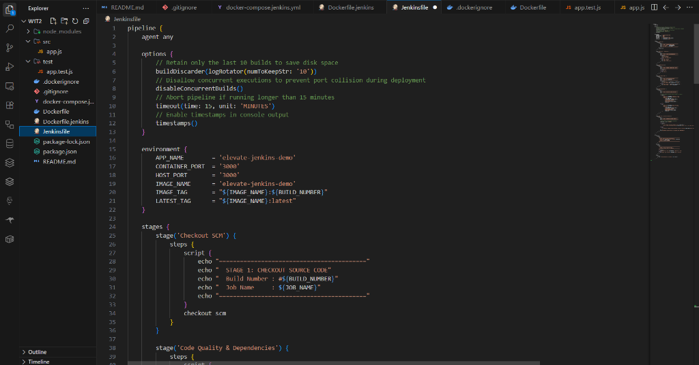
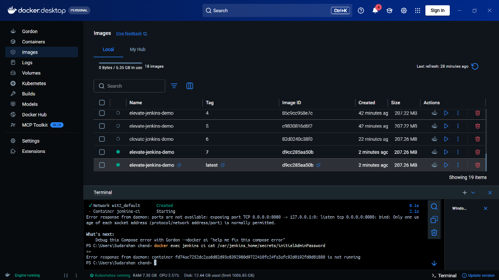
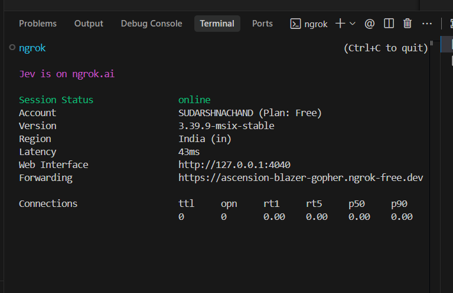
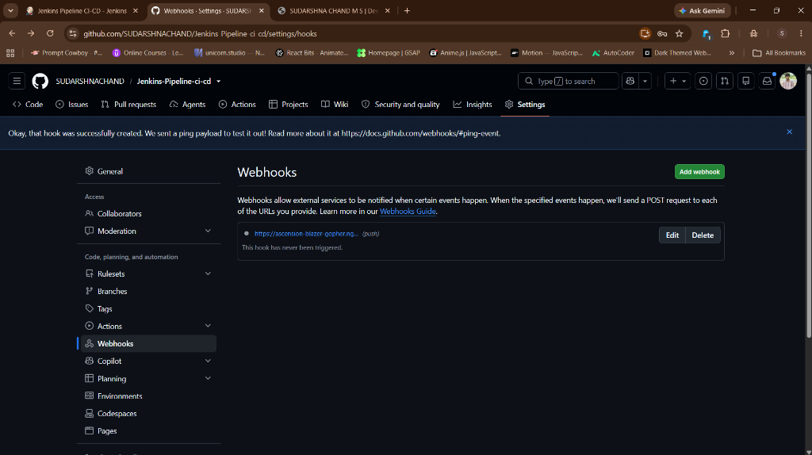
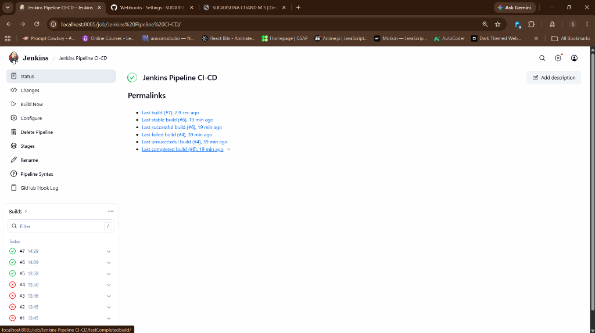
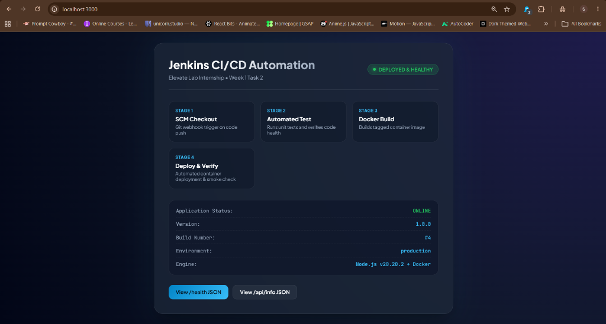

# Elevate Lab Internship - Week 1: Task 2
# Simple Jenkins CI/CD Pipeline for Automated Docker Deployment

A complete, production-grade Continuous Integration and Continuous Deployment (CI/CD) pipeline built with **Jenkins**, **Docker**, and **GitHub Webhooks** to automate the build, test, containerization, and zero-downtime deployment of a microservice web application.

---

## 📑 Table of Contents
- [Project Overview](#-project-overview)
- [Architecture & Workflow](#-architecture--workflow)
- [End-to-End Visual Flow (Step-by-Step Screenshots)](#-end-to-end-visual-flow-step-by-step-screenshots)
  - [Step 1: Codebase & Declarative Pipeline Setup](#step-1-codebase--declarative-pipeline-setup-vs-code)
  - [Step 2: Docker Engine & Containerized Infrastructure](#step-2-docker-engine--containerized-infrastructure-docker-desktop)
  - [Step 3: Secure Webhook Tunneling via Ngrok](#step-3-secure-webhook-tunneling-via-ngrok)
  - [Step 4: GitHub Webhook Integration](#step-4-github-webhook-integration-github)
  - [Step 5: Automated Jenkins Pipeline Execution](#step-5-automated-jenkins-pipeline-execution-jenkins-dashboard)
  - [Step 6: Live Application Deployment & Verification](#step-6-live-application-deployment--verification)
- [Deliverables & File Structure](#-deliverables--file-structure)
- [Pipeline Stages Breakdown](#-pipeline-stages-breakdown)
- [How to Run & Reproduce Locally](#-how-to-run--reproduce-locally)

---

## 🎯 Project Overview
- **Objective**: Set up a basic Jenkins pipeline to automate the process of building, testing, and deploying an application.
- **Tools Used**: Jenkins LTS, Docker & Docker Desktop, GitHub, Ngrok, Node.js.
- **Primary Deliverable**: A Declarative `Jenkinsfile` with automated stages, health verification, and push triggers.

---

## 🔄 Architecture & Workflow

```mermaid
flowchart LR
    A["Developer (git push)"] --> B["GitHub Repository"]
    B -->|"Webhook POST /github-webhook/"| C["Ngrok Secure Tunnel"]
    C --> D["Jenkins CI/CD Controller"]
    subgraph Pipeline ["Jenkins Pipeline (Jenkinsfile)"]
        D --> E["1. Checkout SCM"]
        E --> F["2. Dependencies (npm ci)"]
        F --> G["3. Unit Tests (npm test)"]
        G --> H["4. Build Docker Image"]
        H --> I["5. Deploy Container"]
        I --> J["6. Smoke Test (/health)"]
    end
    J --> K["Live Microservice (Port 3000)"]
```



---

## 📸 End-to-End Visual Flow (Step-by-Step Screenshots)

### Step 1: Codebase & Declarative Pipeline Setup (VS Code)
The project structure is organized with a Node.js microservice (`src/app.js`), automated unit test suite (`test/app.test.js`), production `Dockerfile`, and the core deliverable: a multi-stage Declarative **`Jenkinsfile`**.



*Key Highlights:*
- Cross-platform pipeline syntax supporting both Unix/Linux and Windows environments.
- Automated cleanup via `buildDiscarder` and concurrency locking via `disableConcurrentBuilds`.
- Multi-stage pipeline logic: Checkout ➔ Dependencies ➔ Tests ➔ Docker Build ➔ Deploy ➔ Smoke Test.

---

### Step 2: Docker Engine & Containerized Infrastructure (Docker Desktop)
Docker Desktop manages both the Jenkins CI controller and the deployed application containers. Each pipeline execution tags and archives the built container image with the corresponding build number (`elevate-jenkins-demo:<BUILD_NUMBER>`) alongside `latest`.



*Key Highlights:*
- Images automatically tagged and versioned per build (Build #4, #5, #6, #7, and `latest`).
- Zero-downtime container replacement: stops and removes obsolete container before launching the new version on port `3000`.

---

### Step 3: Secure Webhook Tunneling via Ngrok
Because Jenkins runs locally on `http://localhost:8085`, GitHub requires an accessible public endpoint to dispatch webhook notifications. An **ngrok** tunnel forwards external HTTPS requests directly to the local Jenkins controller.



*Key Highlights:*
- Public HTTPS URL generated (e.g. `https://ascension-blazer-gopher.ngrok-free.dev`).
- Real-time HTTP tunnel forwarding to `http://localhost:8085`.

---

### Step 4: GitHub Webhook Integration (GitHub)
The repository webhook is configured under **Settings > Webhooks** with the ngrok payload URL targeting `/github-webhook/`. GitHub automatically validates connectivity by dispatching a test ping.



*Key Highlights:*
- **Payload URL**: `https://<ngrok-id>.ngrok-free.dev/github-webhook/`
- **Content Type**: `application/json`
- **Trigger**: "Just the push event"
- **Status**: Successfully created and validated with a green checkmark.

---

### Step 5: Automated Jenkins Pipeline Execution (Jenkins Dashboard)
Upon any code push to the `main` branch, GitHub sends a push event to Jenkins, which automatically triggers a new pipeline execution without any manual intervention.



*Key Highlights:*
- Builds **#5**, **#6**, and **#7** were automatically triggered and completed with green **SUCCESS** status.
- Stage View demonstrates successful checkout, dependency installation, unit testing, Docker containerization, deployment, and smoke health testing.

---

### Step 6: Live Application Deployment & Verification
The deployed microservice is live and responsive at **`http://localhost:3000`**, displaying real-time deployment status, version metadata, build number, and health metrics.



*Key Highlights:*
- **URL**: [http://localhost:3000](http://localhost:3000)
- **Healthcheck**: [http://localhost:3000/health](http://localhost:3000/health) returning `{"status": "UP"}`
- **Info API**: [http://localhost:3000/api/info](http://localhost:3000/api/info)
- **Print / PDF Support**: Built-in resume view for professional portfolio presentations.

---

## 📁 Deliverables & File Structure

```
W1T2/
├── Jenkinsfile                 # ⭐ Core Deliverable: Multi-stage Declarative CI/CD Pipeline
├── Dockerfile                  # Application Docker container definition
├── Dockerfile.jenkins          # Custom Jenkins LTS image with Docker CLI and Node.js
├── docker-compose.jenkins.yml  # Docker Compose definition to spin up Jenkins locally
├── .dockerignore               # Docker exclusions
├── .gitignore                  # Git exclusions
├── package.json                # Dependencies, test scripts, and versioning
├── src/
│   └── app.js                  # Express web application & portfolio with /health endpoint
├── test/
│   └── app.test.js             # Automated unit test suite using native Node.js test runner
├── docs/
│   └── screenshots/            # Visual documentation of each step in the pipeline flow
└── README.md                   # Complete documentation manual
```

---

## ⚙️ Pipeline Stages Breakdown

1. **Stage 1: Checkout SCM**
   - Fetches the latest revision from GitHub on the `main` branch.
2. **Stage 2: Code Quality & Dependencies**
   - Verifies Node.js & npm versions and executes `npm ci` for clean dependency installs.
3. **Stage 3: Automated Tests**
   - Runs unit tests via `npm test` (`node --test test/*.test.js`). Halts the pipeline if any test fails.
4. **Stage 4: Build Docker Image**
   - Packages the application into an Alpine-based Docker image tagged as `${APP_NAME}:${BUILD_NUMBER}` and `${APP_NAME}:latest`.
5. **Stage 5: Deploy Application**
   - Gracefully stops and removes previous container instances and launches the new build on port `3000`.
6. **Stage 6: Smoke Test & Health Verification**
   - Queries `http://host.docker.internal:3000/health` to confirm HTTP 200 OK before marking the pipeline run successful.

---

## 🚀 How to Run & Reproduce Locally

### 1. Start Jenkins via Docker Compose
```powershell
docker compose -f docker-compose.jenkins.yml up -d
```
Access Jenkins at: **[http://localhost:8085](http://localhost:8085)**

Retrieve initial admin password:
```powershell
docker exec jenkins-ci cat /var/jenkins_home/secrets/initialAdminPassword
```

### 2. Start Ngrok Tunnel
```powershell
ngrok http 8085
```

### 3. Add GitHub Webhook
Under repository **Settings > Webhooks > Add webhook**:
- **Payload URL**: `https://<YOUR-NGROK-URL>/github-webhook/`
- **Content type**: `application/json`
- **Event**: Push event

### 4. Push Code to Trigger Automated Build
```powershell
git commit -am "test: trigger automated pipeline build"
git push origin main
```
Jenkins will instantly pick up the push and deploy the new version to **[http://localhost:3000](http://localhost:3000)**!
